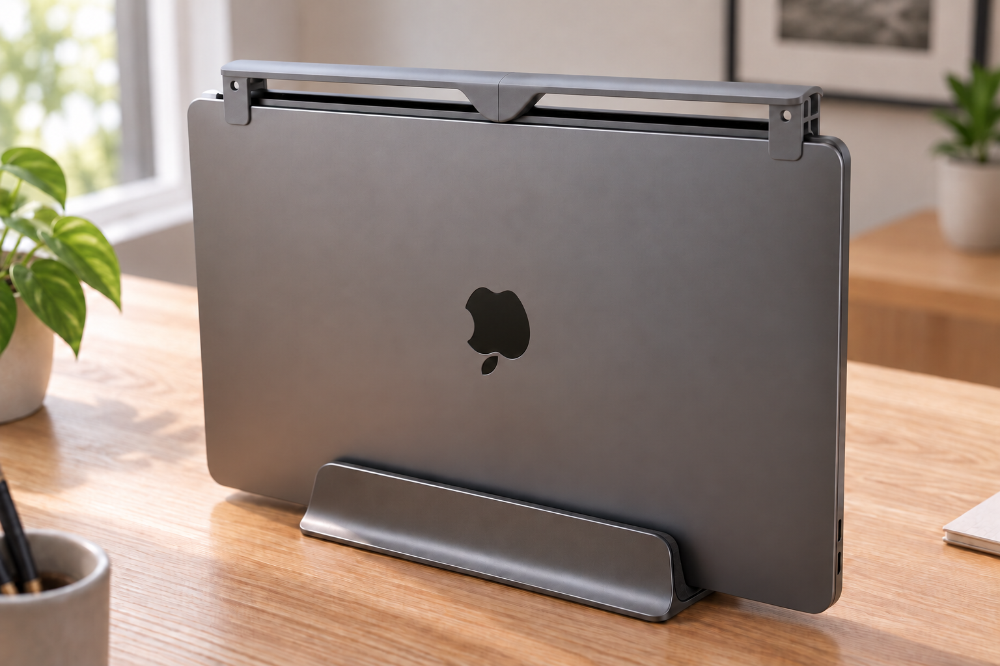
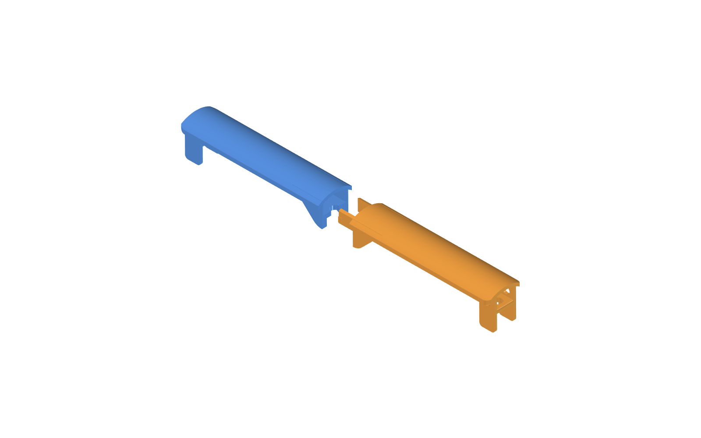

# MacBook Pro 14" M5 환기구 먼지 덮개

세로로 세워 클램쉘 모드로 쓰는 MacBook Pro 14인치(M5)의 **위를 향한 힌지 환기구** 위에 얹는 먼지 덮개입니다. 위에서 떨어지는 먼지는 지붕이 막고, 공기는 좌우·앞뒤로 자유롭게 빠집니다. Bambu Lab X1C(256×256mm)에서 출력하도록 **2조각**으로 나누었고, 서포트 없이 뽑히도록 설계했습니다.

> **상태:** 모델과 자동 검증까지 끝났고, 실제 출력본을 맥북에 얹어 본 확인은 아직 하지 않았습니다. 힌지 띠 길이(272mm)는 사진으로 추정한 값이라 첫 출력에서 맞춰 봐야 합니다.



회색 덮개를 장착한 모습의 AI 생성 렌더링입니다.


파란색이 왼쪽 조각, 주황색이 오른쪽 조각입니다.

## 구조

덮개는 지붕 하나와 양 끝의 다리 탭, 가운데 이음선으로 이루어집니다. 왼쪽 끝에서 오른쪽 끝으로 가면 다음과 같습니다.

```
바깥 탭(홀 있음) → 아치형 지붕 → 안쪽 탭(둥근 다리) ⇄ 이음선(겹친 다리 + 스냅 후크) ⇄ 안쪽 탭(둥근 다리) → 아치형 지붕 → 바깥 탭(홀 있음)
```

### 지붕

- 단면이 아치형입니다. 맥북 윗면에서 가장자리까지 **12mm**, 가운데까지 **18mm** 떠 있어 뜨거운 공기가 올라갈 공간이 있습니다.
- 두께 3mm, 폭 33.5mm이고 양쪽으로 6mm씩 처마를 내밀어 위에서 떨어지는 먼지를 가립니다.
- 지붕 아래 좌우와 앞뒤는 열려 있습니다. 공기가 지나가는 길을 막지 않습니다.

### H자 탭과 원형 홀

맥북 윗면을 잡는 끝 탭은 옆에서 보면 **H자**입니다. 다리 두 장이 기둥이고 얇은 가로대(4mm)가 이어 줍니다. 가로대 아랫면이 맥북 윗면에 얹힙니다.


- **바깥 탭**(양 끝): 다리가 맥북 윗면 아래로 14mm 내려가 옆면을 잡습니다. 다리에 지름 7mm 원형 창(앞뒤로 공기 통과), 가로대에 지름 8mm 원형 홀(환기구 쪽에서 위로 공기 통과)이 있습니다. 다리 아래 모서리(반지름 3mm)와 가로대 끝(반지름 1.5mm)은 둥글게 처리했습니다.
- **안쪽 탭**(가운데 쪽): 이음선 쪽 바닥이 둥근 곡선이고 그 뒤는 45° 경사로 지붕까지 올라가는 다리입니다. 다리는 바깥에 판을 한 장 덧대 두 겹(4.8mm)입니다. 가로대에 이음선을 중심으로 지름 8mm 원형 홀이 있고, 두 조각에 반원씩 나뉘어 조립하면 하나의 원이 됩니다.
- 홀을 원형으로 한 이유는 사각 홀의 평평한 윗변이 서포트를 필요로 하기 때문입니다.

### 가운데 이음선

두 조각의 안쪽 탭 수직 모서리가 이음선에서 0.05mm 틈으로 맞닿습니다. 다리 바닥은 이음선 바로 아래를 중심으로 한 반지름 12mm 원호라, 양쪽 조각의 곡선이 이음선에서 수평으로 만나 **하나의 둥근 곡선(U자)처럼 이어집니다.** 가운데가 떠 보이지 않습니다. 원호 뒤는 서포트 없이 쌓이는 한계 각도인 45° 직선으로 지붕까지 이어집니다.


### 이음 (겹친 다리 + 스냅 후크)

두 조각은 이음선 아래쪽의 겹친 다리(혀)와 그 끝의 스냅 후크로 고정합니다. 따로 부품이나 접착제를 쓰지 않고, 한 번 끼우면 빠지지 않는 영구 결합입니다.

- 오른쪽 조각의 안쪽 다리(혀, 두께 2.4mm)가 이음선을 넘어 **16mm** 왼쪽으로 뻗어, 왼쪽 조각 바깥 판의 안쪽으로 들어갑니다. 혀 아랫면은 맥북 윗면 위 약 5.1mm에서 수평입니다(혀 끝에서 안쪽 다리 45° 경사가 지나는 높이). 왼쪽 조각은 그 위쪽의 안쪽 겹만 비우고, 그 아래 안쪽 겹과 가로대는 그대로 둡니다.
- 혀 끝 바깥면에 **네모 턱**(돌출 0.6mm, 길이 3mm, 높이 5mm)이 바깥쪽(두께 방향)으로 튀어나와 있습니다. 이음선 쪽 면이 90° 걸쇠 면입니다.
- 턱 앞이 직각이므로 경사는 왼쪽 바깥 판에 있습니다. 바깥 판 끝(이음선)의 안쪽 모서리를 1mm 45°로 모따기해, 밀어 넣을 때 턱이 이 경사를 타고 혀를 안쪽으로 휘게 합니다.
- 왼쪽 바깥 판 안쪽 면에 턱보다 사방 0.05mm 큰 **막힌 홈**(깊이 0.65mm)이 있습니다. 바깥에서는 보이지 않습니다.
- 턱과 홈은 다리 높이의 **가운데**(맥북 윗면 위 6~11mm)에만 있습니다. 그 위아래로는 혀가 평평하게 남아 홈의 위아래 벽에 걸리므로 위아래로도 빠지지 않습니다.
- 혀는 끼울 때 0.6mm 휘어야 합니다. 출력 방향 때문에 층과 층 사이로 휘므로, 휨 변형률이 1% 이하가 되도록 혀를 길게 했습니다(1.5 × 2.35 × 0.6 / 16.05² ≈ 0.82%). 혀 뿌리(오른쪽 바깥 판과 만나는 안쪽 모서리)는 반지름 1mm로 둥글게 해 힘이 한 점에 몰리지 않게 했습니다.

| 움직임 | 막는 것 |
|---|---|
| 길이 방향으로 당기기 | 턱의 90° 걸쇠 면 |
| 길이 방향으로 밀기 | 이음선 면 맞닿음 |
| 옆(앞뒤)으로 밀기 | 겹친 다리와 바깥 판 |
| 위로 올리기 | 혀 위쪽이 왼쪽 지붕에 닿음 + 턱 |
| 아래로 빼기 | 혀 아랫면이 왼쪽 안쪽 겹에 닿음 + 턱 |

턱을 없앤 모델로 확인하면 당기기는 아무것도 막지 않습니다. 이 방향은 후크만이 막습니다.

조립은 **길이 방향으로 밀어 넣는 것** 하나뿐입니다. 턱이 바깥 판에 걸려 아래나 위에서는 끼울 수 없습니다.

```
오른쪽 조각을 길이 방향으로 밀어 넣기 → 바깥 판 끝 모따기가 턱을 밀어 혀를 안쪽으로 휘게 함 → 이음선이 맞닿으며 턱이 홈에 딸깍 걸림
```




## 치수

| 항목 | 값 | 근거 |
|---|---|---|
| 맥북 외형 (가로 × 세로 × 두께) | 312.6 × 221.2 × 15.5mm | Apple 한국 사양 페이지 직접 조회 |
| 덮개 전체 길이 | 272mm | 힌지 띠 길이(240~270mm 추정)에 여유를 더함. **추정, 낮은 신뢰도** |
| 왼쪽 조각 | 136 × 33.5 × 35mm | 모델 |
| 오른쪽 조각 | 152 × 33.5 × 35mm (이음선을 넘는 혀 16mm 포함) | 모델 |
| 지붕 간격 (가장자리 / 가운데) | 12 / 18mm | 설계값 |
| 이음선 틈 | 0.05mm (겹친 다리 여유도 같은 값) | 설계값 |
| 스냅 후크 | 혀 16mm(아랫면 높이 약 5.1mm), 네모 턱 0.6 × 3 × 5mm (높이 6~11mm), 홈 깊이 0.65mm, 바깥 판 끝 모따기 1mm | 설계값 |

## 만드는 법

모델은 FreeCAD 스크립트 한 개에 치수를 모아 두었고, 값을 바꿔 다시 실행하면 STL이 새로 만들어집니다.

```
파라미터 수정 → dust_cover.py 실행 → check_cover.py 검증 → render_images.py (이미지 갱신) → Bambu Studio 출력
```

```bash
F=/Applications/FreeCAD.app/Contents/Resources/bin/freecadcmd
$F dust_cover.py        # cover-left.stl, cover-right.stl 생성
$F check_cover.py       # PASS 5줄이면 정상
/Applications/FreeCAD.app/Contents/MacOS/FreeCAD render_images.py   # images/ 갱신 (GUI가 잠깐 열렸다 닫힘)
```

### 파일

| 파일 | 설명 |
|---|---|
| `dust_cover.py` | 모델 생성. 파라미터는 파일 맨 위 |
| `check_cover.py` | 기하 검증 (아래 참고) |
| `render_images.py` | 이 README의 이미지를 FreeCAD 화면에서 캡처 |
| `cover-left.stl`, `cover-right.stl` | 출력용 모델 |
| `images/` | README 이미지 |

### 검증

`check_cover.py`는 STL을 읽어 아래 다섯 가지를 숫자로 검사합니다. 현재 모두 PASS입니다.

| 항목 | 기준 | 현재 |
|---|---|---|
| (a) 출력 가능 | 각 조각이 250mm 이하이고, 세워 쌓을 때 서포트가 필요한 면 덩어리가 45mm² 이하 | 최대 23.9mm² (원형 홀 꼭대기 호) |
| (b) 이음 | 조립한 자리에서 조각 간 간섭 0 (조립 경로는 혀가 휘어야 들어가므로 검사하지 않음) | 0 |
| (c) 환기와 다리 | 지붕 간격 10~15mm, 지붕 아래 열림, 바깥 탭 홀과 이음선 홀이 뚫림, 이음선에서 양쪽 다리가 맞닿음 | 모두 만족 |
| (d) 형상 | 닫힌 솔리드이고 조각마다 한 덩어리 | 만족 |
| (e) 스냅 후크 | 예전 고정 구멍 자리가 메워져 있고, 오른쪽 조각을 당기는 방향·위·아래로 0.5mm 옮기면 모두 걸리며, 혀의 휨 변형률이 1.0% 이하 | 가장 약한 걸림 2.5mm³, 변형률 0.82% |

## 출력

바깥 둥근 끝면을 베드에 대고 **세워서** 출력합니다. 왼쪽 조각은 +X 방향으로, 오른쪽 조각은 -X 방향으로 쌓이고, 쌓는 방향과 나란한 면이 대부분이라 서포트가 필요 없습니다.


1. 두 STL을 Bambu Studio에서 불러옵니다.
2. **왼쪽 조각:** 둥근 끝을 아래로 세웁니다. 이음선 쪽이 맨 위가 됩니다. 높이 136mm.
3. **오른쪽 조각:** 둥근 끝을 아래로 세웁니다. 이음선을 넘는 혀가 맨 위가 됩니다. 높이 152mm.
4. 서포트는 끕니다. 베드에 닿는 면이 작으니 브림을 켜는 것을 권합니다.
5. PLA 기준으로 레이어 0.2mm, 벽 3줄, 채움 15~20%를 시작값으로 쓰세요.

## 조립과 설치

1. 가로대 아랫면(조각마다 2곳, 총 4곳)에 두께 1mm 펠트나 TPU 패드를 붙입니다. 알루미늄 윗면 스크래치를 막는 용도이고, 지붕 간격 12mm에는 이 1mm가 이미 포함되어 있습니다.
2. 오른쪽 조각을 길이 방향으로 밀어, 혀를 왼쪽 바깥 판 안쪽으로 넣습니다. 끝까지 밀면 이음선이 맞닿으면서 앞뒤 턱이 홈에 딸깍 걸립니다. 접착은 필요 없습니다. 한 번 걸리면 빼지 못하니 맥북에 얹을 방향을 확인하고 끼우세요.
3. 맥북 환기구(힌지 띠) 위에 얹습니다. 다리가 맥북 두께 방향 양쪽을 감싸고, 가로대가 윗면에 얹힙니다.

## 맞지 않을 때 고칠 파라미터

`dust_cover.py` 맨 위의 값을 고친 뒤 `dust_cover.py`, `check_cover.py`를 다시 실행합니다.

| 증상 | 파라미터 (현재값) |
|---|---|
| 힌지 띠보다 짧거나 길다 | `TOTAL_LEN` (272) |
| 다리가 헐겁거나 꽉 낀다 | `CLEAR` (0.6) |
| 다리가 슬릿이나 케이블에 걸린다 | `SKIRT_DEPTH` (14), `INNER_DEPTH` (6), `TAB` (15) |
| 열이 고인다 | `GAP` (12, 10~15), `ROOF_RISE` (6) |
| 더 둥글게 또는 덜 둥글게 | `ROOF_RISE` (0이면 평평), `CORNER_R` (8, 덮개 끝 모서리), `LEG_R` (3, 바깥 다리 아래 모서리), `BAR_R` (1.5, 가로대 끝) |
| 이음선의 다리 곡선을 바꾸고 싶다 | `SEAM_R` (12, 클수록 완만하고 안쪽 탭이 길어짐), `INNER_DEPTH` (6) |
| 공기가 더 잘 흘러야 한다 | `BAR_HOLE_D` (8, 이음선 홀도 같은 지름), `SKIRT_HOLE_D` (7), `SKIRT_HOLE_Z` (10) |
| 후크가 안 걸리거나 너무 뻑뻑하다 | `HOOK_H` (0.6, 턱 돌출), `HOOK_LEN` (3), `HOOK_Z` (8.5), `HOOK_ZH` (5), 혀 길이 `LAP` (16), 혀 뿌리 `HOOK_ROOT_R` (1), 바깥 판 끝 모따기 `HOOK_LEAD` (1, 턱 돌출보다 커야 함) |
| 혀가 안 들어간다 | `SEAM_CLEAR` (0.05, 안 들어가면 0.1) |

## 알려진 한계

- **힌지 띠 길이**: 272mm는 추정입니다. 오른쪽 끝 케이블, 왼쪽 끝 단차, 뒤쪽 물체와의 간격은 실물로 확인하지 않았습니다.
- **PLA 내열**: 지붕 아래 배기 공기가 PLA 연화 온도(약 55~60°C)에 가까워질 수 있습니다. 부하를 건 뒤 지붕이 무르거나 휘면 PETG로 다시 출력하세요.
- **영구 결합**: 후크는 한 번 걸리면 빼는 방법이 없습니다. 분리하려면 부숴야 합니다. 치수를 맞추느라 다시 출력하면 두 조각을 모두 새로 뽑아야 합니다.
- **지붕 처짐**: 지붕을 받치는 탭 사이가 약 92mm입니다. PLA에서 처짐이 있는지 출력 후 확인하세요.
- **안쪽 다리**: 맥북 윗면 아래로 이음선에서만 6mm 내려가고, 거기서 멀어질수록 얕아져 옆면을 잡는 힘은 약합니다. 위치는 바깥 탭 다리가 주로 잡습니다.
- **원형 홀 꼭대기**: 지름이 작아 서포트 없이 나오지만 약간 처질 수 있습니다.
- **혀 뿌리 강도**: 혀가 출력 층 사이 방향으로 휩니다. 변형률은 약 0.82%로 계산했지만 PLA 층간 접착이 이를 버티는지는 출력해 봐야 압니다. 끼울 때 혀 뿌리에 흰 줄이 생기거나 갈라지면 `HOOK_H`를 0.4로 줄이세요.
- **혀가 안쪽으로 밀리면 풀림**: 혀 안쪽(맥북 쪽)은 막혀 있지 않습니다. 걸쇠 면이 90°라 당기기만 해서는 풀리지 않지만, 혀를 안쪽으로 0.6mm 이상 누르면서 당기면 빠질 수 있습니다.
- **홈 꼭대기**: 왼쪽 조각을 세워 출력하면 홈의 이음선 쪽 벽이 약 3mm² 크기의 작은 오버행이 됩니다. 서포트 없이 나오지만 약간 처질 수 있습니다.
