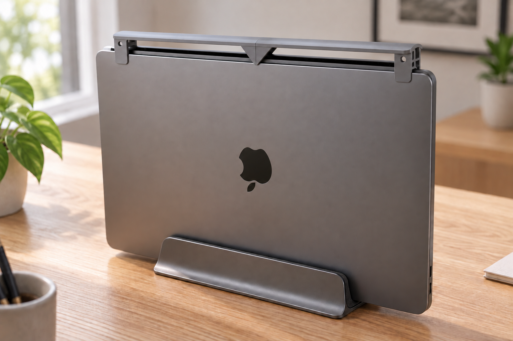
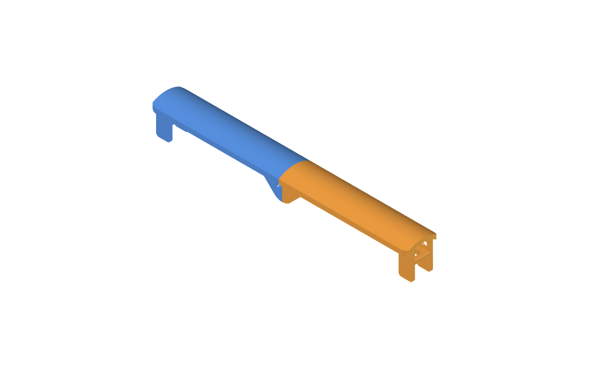
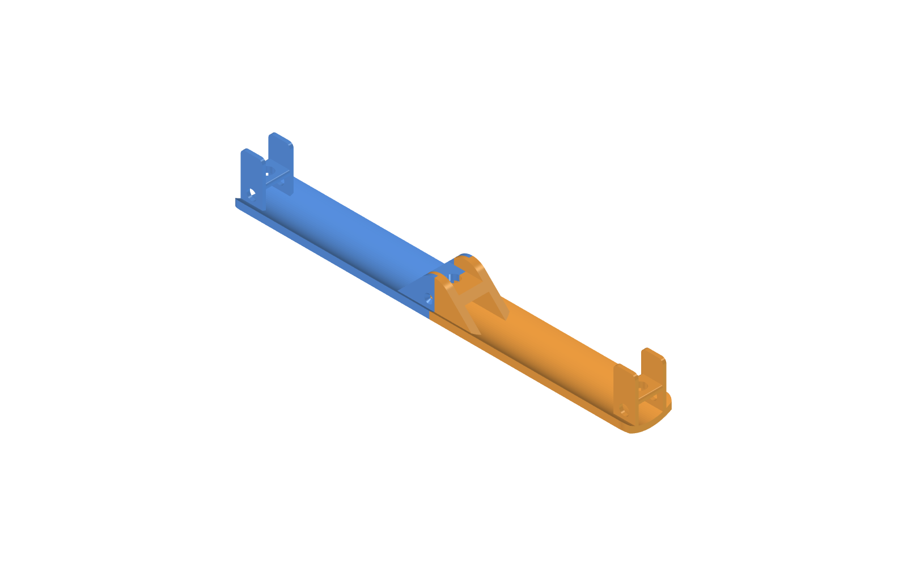
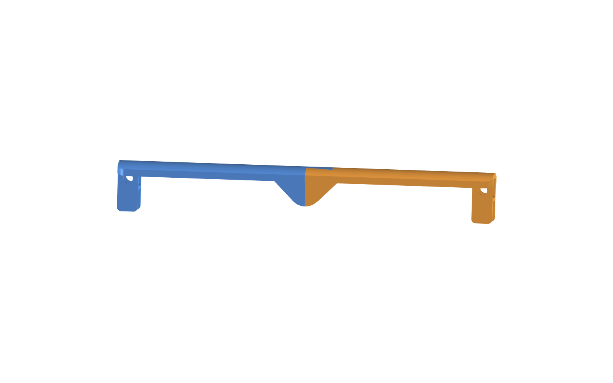
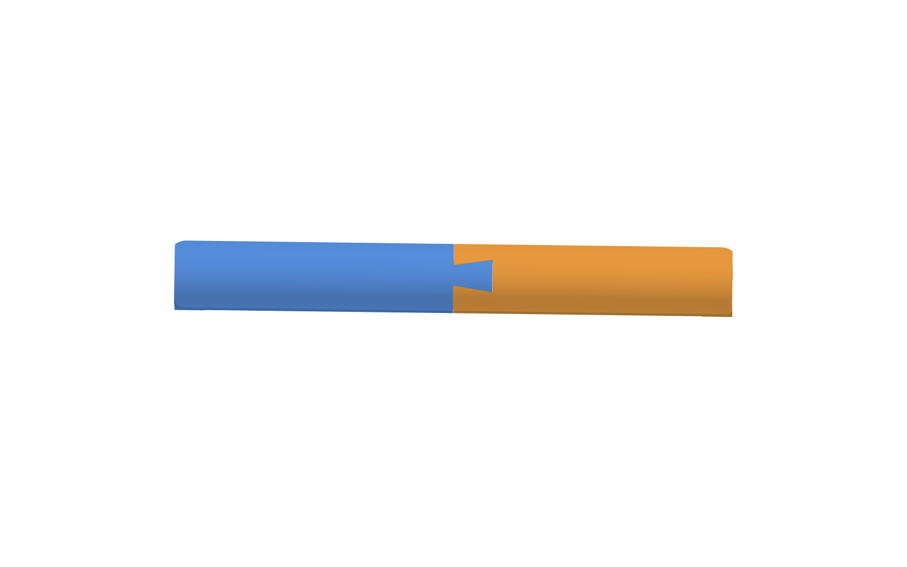
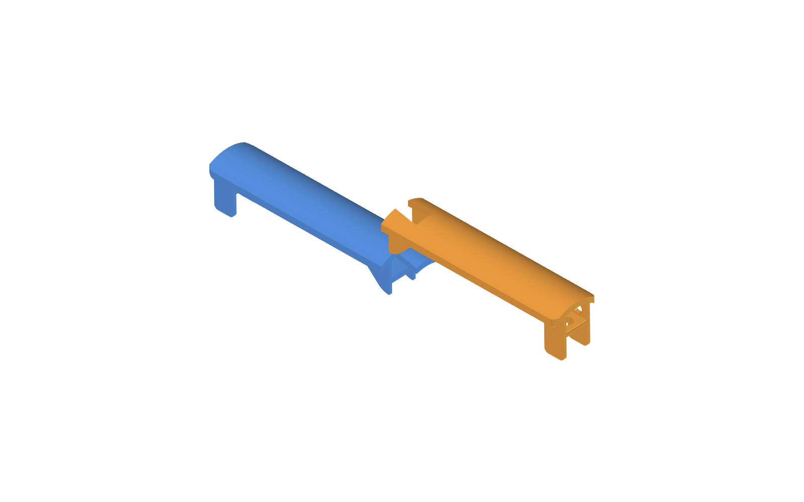
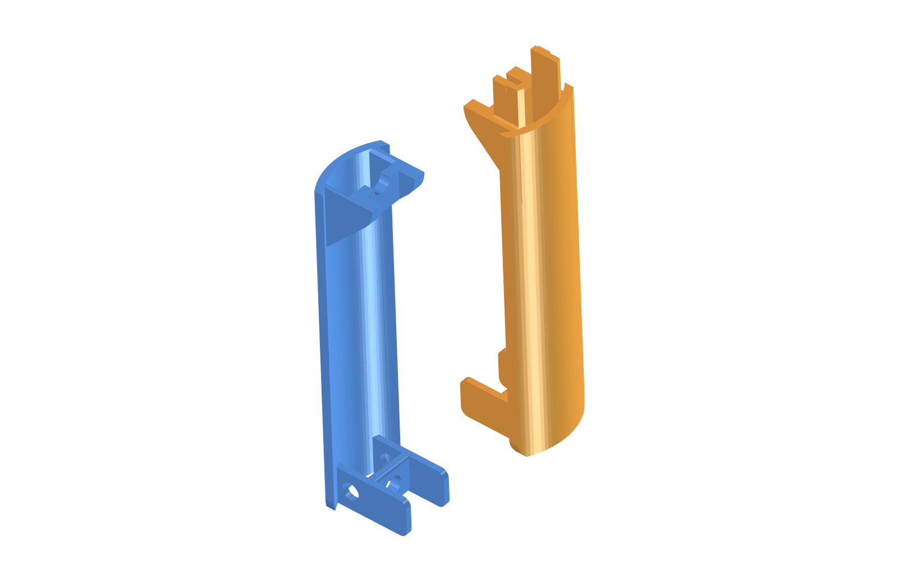

# MacBook Pro 14" M5 환기구 먼지 덮개

세로로 세워 클램쉘 모드로 쓰는 MacBook Pro 14인치(M5)의 **위를 향한 힌지 환기구** 위에 얹는 먼지 덮개입니다. 위에서 떨어지는 먼지는 지붕이 막고, 공기는 좌우·앞뒤로 자유롭게 빠집니다. Bambu Lab X1C(256×256mm)에서 출력하도록 **2조각**으로 나누었고, 서포트 없이 뽑히도록 설계했습니다.

> **상태:** 모델과 자동 검증까지 끝났고, 실제 출력본을 맥북에 얹어 본 확인은 아직 하지 않았습니다. 힌지 띠 길이(272mm)는 사진으로 추정한 값이라 첫 출력에서 맞춰 봐야 합니다.



회색 덮개를 장착한 모습의 AI 생성 렌더링입니다.



파란색이 왼쪽 조각, 주황색이 오른쪽 조각입니다.

## 구조

덮개는 지붕 하나와 양 끝의 다리 탭, 가운데 이음선으로 이루어집니다. 왼쪽 끝에서 오른쪽 끝으로 가면 다음과 같습니다.

```
바깥 탭(홀 있음) → 아치형 지붕 → 안쪽 탭(삼각 다리) ⇄ 도브테일 이음선 ⇄ 안쪽 탭(삼각 다리) → 아치형 지붕 → 바깥 탭(홀 있음)
```

### 지붕

- 단면이 아치형입니다. 맥북 윗면에서 가장자리까지 **12mm**, 가운데까지 **18mm** 떠 있어 뜨거운 공기가 올라갈 공간이 있습니다.
- 두께 4mm, 폭 33.5mm이고 양쪽으로 6mm씩 처마를 내밀어 위에서 떨어지는 먼지를 가립니다.
- 지붕 아래 좌우와 앞뒤는 열려 있습니다. 공기가 지나가는 길을 막지 않습니다.

### H자 탭과 원형 홀

맥북 윗면을 잡는 끝 탭은 옆에서 보면 **H자**입니다. 다리 두 장이 기둥이고 얇은 가로대(4mm)가 이어 줍니다. 가로대 아랫면이 맥북 윗면에 얹힙니다.



- **바깥 탭**(양 끝): 다리가 맥북 윗면 아래로 14mm 내려가 옆면을 잡습니다. 다리에 지름 7mm 원형 창(앞뒤로 공기 통과), 가로대에 지름 8mm 원형 홀(환기구 쪽에서 위로 공기 통과)이 있습니다.
- **안쪽 탭**(가운데 쪽): 앞쪽 끝을 45°로 깎은 삼각 다리입니다. 홀은 뚫지 않았습니다.
- 홀을 원형으로 한 이유는 사각 홀의 평평한 윗변이 서포트를 필요로 하기 때문입니다.

### 가운데 이음선

두 조각의 안쪽 탭 수직 모서리가 이음선에서 0.12mm 틈으로 맞닿아 **V자로 이어집니다.** 가운데가 떠 보이지 않습니다.



### 도브테일 이음

왼쪽 조각의 끝이 넓은 장부(길이 19mm, 뿌리 10mm에서 끝 16mm)를 오른쪽 조각의 홈에 **위에서 아래로** 끼웁니다. 길이 방향으로 당겨도 빠지지 않고, 위로만 분리됩니다.





## 치수

| 항목 | 값 | 근거 |
|---|---|---|
| 맥북 외형 (가로 × 세로 × 두께) | 312.6 × 221.2 × 15.5mm | Apple 한국 사양 페이지 직접 조회 |
| 덮개 전체 길이 | 272mm | 힌지 띠 길이(240~270mm 추정)에 여유를 더함. **추정, 낮은 신뢰도** |
| 왼쪽 조각 | 155 × 33.5 × 36mm | 모델 |
| 오른쪽 조각 | 136 × 33.5 × 36mm | 모델 |
| 지붕 간격 (가장자리 / 가운데) | 12 / 18mm | 설계값 |
| 도브테일 맞물림 | 19mm, 한쪽 유격 0.12mm | 설계값 |

## 만드는 법

모델은 FreeCAD 스크립트 한 개에 치수를 모아 두었고, 값을 바꿔 다시 실행하면 STL이 새로 만들어집니다.

```
파라미터 수정 → dust_cover.py 실행 → check_cover.py 검증 → render_images.py (이미지 갱신) → Bambu Studio 출력
```

```bash
F=/Applications/FreeCAD.app/Contents/Resources/bin/freecadcmd
$F dust_cover.py        # cover-left.stl, cover-right.stl 생성
$F check_cover.py       # PASS 4줄이면 정상
/Applications/FreeCAD.app/Contents/MacOS/FreeCAD render_images.py   # images/ 갱신 (GUI가 잠깐 열렸다 닫힘)
```

### 파일

| 파일 | 설명 |
|---|---|
| `dust_cover.py` | 모델 생성. 파라미터는 파일 맨 위 |
| `check_cover.py` | 기하 검증 (아래 참고) |
| `render_images.py` | 이 README의 이미지를 FreeCAD 화면에서 캡처 |
| `cover-left.stl`, `cover-right.stl` | 출력용 모델 |
| `images/` | README 이미지 |

### 검증

`check_cover.py`는 STL을 읽어 아래 네 가지를 숫자로 검사합니다. 현재 모두 PASS입니다.

| 항목 | 기준 | 현재 |
|---|---|---|
| (a) 출력 가능 | 각 조각이 250mm 이하이고, 세워 쌓을 때 서포트가 필요한 면 덩어리가 45mm² 이하 | 최대 23.9mm² (원형 홀 꼭대기 호) |
| (b) 이음 | 맞물림 15~20mm, 조각 간 간섭 0, 한쪽을 ±1mm 밀면 도브테일이 걸림 | 18.9mm, 간섭 0, 걸림 6.9mm³ |
| (c) 환기와 다리 | 지붕 간격 10~15mm, 지붕 아래 열림, 바깥 탭 홀이 뚫림, 이음선에서 양쪽 다리가 맞닿음 | 모두 만족 |
| (d) 형상 | 닫힌 솔리드이고 조각마다 한 덩어리 | 만족 |

## 출력

바깥 둥근 끝면을 베드에 대고 **세워서** 출력합니다. 왼쪽 조각은 +X 방향으로, 오른쪽 조각은 -X 방향으로 쌓이고, 쌓는 방향과 나란한 면이 대부분이라 서포트가 필요 없습니다.



1. 두 STL을 Bambu Studio에서 불러옵니다.
2. **왼쪽 조각:** 둥근 끝(도브테일 장부가 없는 쪽)을 아래로 세웁니다. 장부가 맨 위가 됩니다. 높이 155mm.
3. **오른쪽 조각:** 둥근 끝(도브테일 홈이 없는 쪽)을 아래로 세웁니다. 홈이 맨 위로 열립니다. 높이 136mm.
4. 서포트는 끕니다. 베드에 닿는 면이 작으니 브림을 켜는 것을 권합니다.
5. PLA 기준으로 레이어 0.2mm, 벽 3줄, 채움 15~20%를 시작값으로 쓰세요.

## 조립과 설치

1. 가로대 아랫면(조각마다 2곳, 총 4곳)에 두께 1mm 펠트나 TPU 패드를 붙입니다. 알루미늄 윗면 스크래치를 막는 용도이고, 지붕 간격 12mm에는 이 1mm가 이미 포함되어 있습니다.
2. 오른쪽 조각을 위에서 내려 왼쪽 장부를 홈에 끼웁니다. 접착은 필요 없습니다. 처음에 뻑뻑하면 장부 옆면을 사포로 살짝 다듬으세요.
3. 맥북 환기구(힌지 띠) 위에 얹습니다. 다리가 맥북 두께 방향 양쪽을 감싸고, 가로대가 윗면에 얹힙니다.

## 맞지 않을 때 고칠 파라미터

`dust_cover.py` 맨 위의 값을 고친 뒤 `dust_cover.py`, `check_cover.py`를 다시 실행합니다.

| 증상 | 파라미터 (현재값) |
|---|---|
| 힌지 띠보다 짧거나 길다 | `TOTAL_LEN` (272) |
| 다리가 헐겁거나 꽉 낀다 | `CLEAR` (0.6) |
| 다리가 슬릿이나 케이블에 걸린다 | `SKIRT_DEPTH` (14), `INNER_DEPTH` (6), `TAB` (15) |
| 열이 고인다 | `GAP` (12, 10~15), `ROOF_RISE` (6) |
| 더 둥글게 또는 덜 둥글게 | `ROOF_RISE` (0이면 평평), `CORNER_R` (8) |
| 공기가 더 잘 흘러야 한다 | `BAR_HOLE_D` (8), `SKIRT_HOLE_D` (7), `SKIRT_HOLE_Z` (10) |
| 도브테일이 안 들어가거나 헐겁다 | `DT_CLEAR` (0.12, 꽉 끼면 0.15, 헐거우면 0.1), `DT_LEN` (19, 15~20) |

도브테일 끝 폭을 키우면(`DT_ROOT`, `DT_FLARE`) 다리 안쪽 면(중심에서 8.35mm)과 겹칩니다. 끝 반폭은 8.1mm 이하로 유지하세요.

## 알려진 한계

- **힌지 띠 길이**: 272mm는 추정입니다. 오른쪽 끝 케이블, 왼쪽 끝 단차, 뒤쪽 물체와의 간격은 실물로 확인하지 않았습니다.
- **PLA 내열**: 지붕 아래 배기 공기가 PLA 연화 온도(약 55~60°C)에 가까워질 수 있습니다. 부하를 건 뒤 지붕이 무르거나 휘면 PETG로 다시 출력하세요.
- **도브테일 유격**: 0.12mm는 FDM에서 빠듯합니다. 출력기와 소재에 따라 조정이 필요할 수 있습니다.
- **지붕 처짐**: 지붕을 받치는 탭 사이가 약 97mm입니다. PLA에서 처짐이 있는지 출력 후 확인하세요.
- **안쪽 다리**: 맥북 윗면 아래로 6mm만 내려가서 옆면을 잡는 힘은 약합니다. 위치는 바깥 탭 다리가 주로 잡습니다.
- **원형 홀 꼭대기**: 지름이 작아 서포트 없이 나오지만 약간 처질 수 있습니다.
